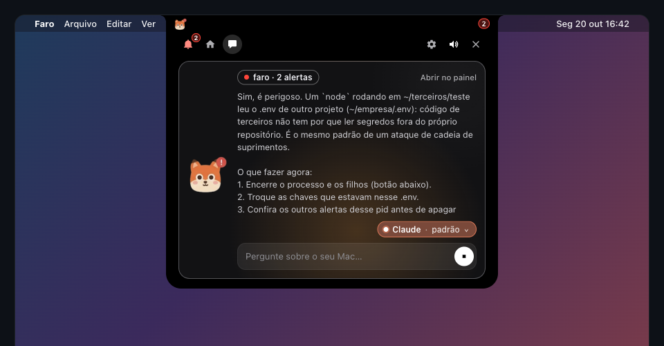
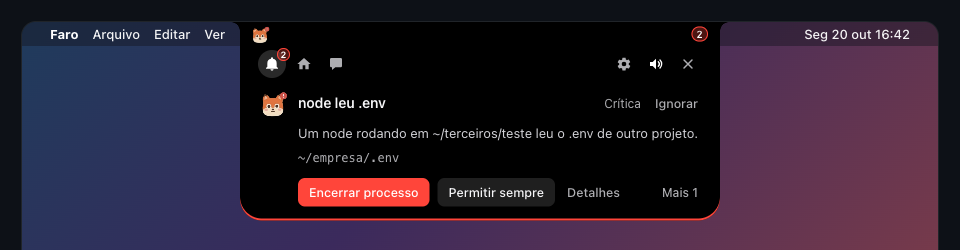
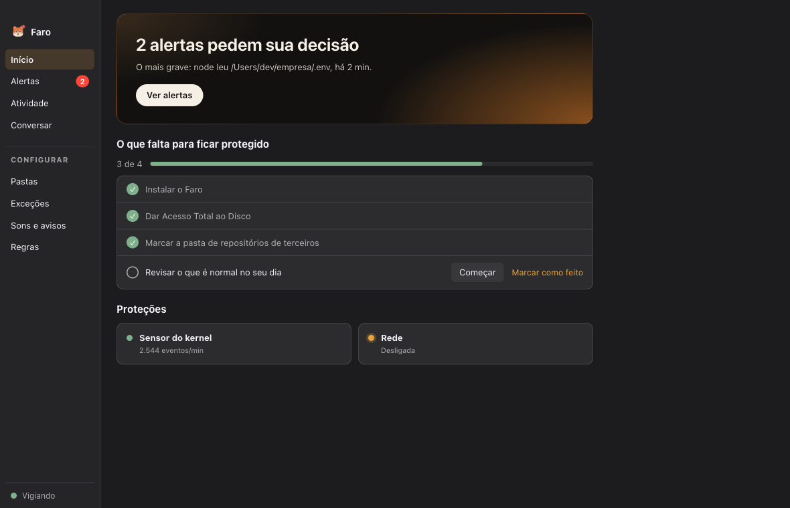
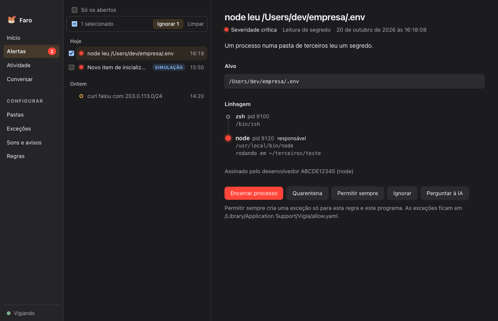
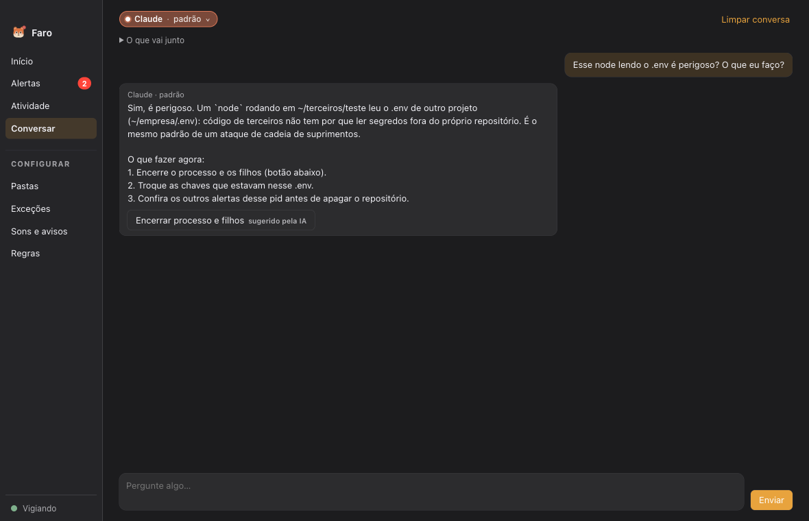
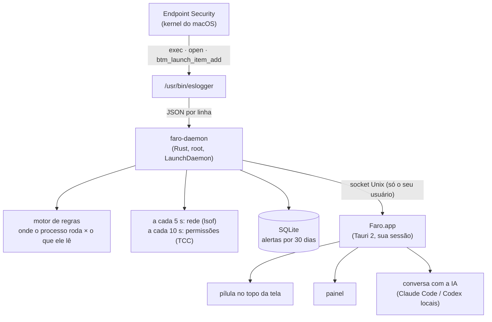

<div align="center">


# Faro

**A raposinha que fareja quem mexe nos seus segredos.**

Monitor de segurança em tempo real para o macOS, que mora no topo da tela.
Viu um processo de código de terceiros lendo o `.env` de outro projeto, chamando `curl | sh`
ou se instalando no login? O Faro avisa na hora, com um botão para encerrar.

[](https://github.com/natan1506/faro/actions/workflows/build.yml)




</div>

---

## Por que existe

Clonar um repositório para rodar uma vez é rotina. Basta um deles ser malicioso, mesmo parecendo **legítimo e inofensivo**, para que em poucos segundos:

1. um `node` rodando dentro do repositório **leia os `.env` de outros projetos** e as credenciais da AWS;
2. chame `curl ... | sh`;
3. baixe e rode um **binário sem assinatura** em `/tmp`;
4. registre um **LaunchAgent** para voltar a cada login.

O antivírus não vê nada, porque nada disso é "vírus": é `node`, `curl` e `launchctl`, as mesmas ferramentas que usamos o dia inteiro. O que denuncia o ataque é o **contexto**: código de uma pasta de terceiros mexendo em segredos de outro projeto.

O Faro existe para enxergar esse contexto. Ele observa o que os processos fazem pelo **Endpoint Security** do macOS e pergunta *onde* cada processo roda, não só *qual programa* ele é. O `next dev` lendo o `.env` do próprio projeto é normal. O mesmo `node`, rodando num repositório de terceiros e lendo o `.env` de outro projeto, vira um alerta crítico.

> O Faro **detecta**, ele não **bloqueia**: o alerta chega frações de segundo depois da ação. Ele complementa um cofre de segredos (tirar os `.env` do disco), não o substitui.

## Visual

A estilização do Faro é inspirada no **[Coucou](https://github.com/Louis-CFM/coucou)**, um app de notch para macOS. Obrigado pela inspiração. 🦊

## Telas

<table>
  <tr>
    <td colspan="2" align="center">
      <br/>
      <sub><b>Fechada:</b> só a raposinha e o contador, no lugar do notch.</sub>
    </td>
  </tr>
  <tr>
    <td colspan="2" align="center">
      <br/>
      <sub><b>Alerta novo:</b> desce aberto, com as ações. A aba do sino guarda a fila.</sub>
    </td>
  </tr>
  <tr>
    <td width="50%"><br/><sub><b>Início:</b> o estado do Mac e o que falta para ficar protegido.</sub></td>
    <td width="50%"><br/><sub><b>Alertas:</b> detalhe, linhagem do processo e ação em massa.</sub></td>
  </tr>
  <tr>
    <td colspan="2"><br/><sub><b>Conversar:</b> pergunte à IA sobre o que o Faro está vendo. Ela explica e sugere; quem decide é você.</sub></td>
  </tr>
</table>

## O que ele faz

- 🦊 **Vigi, a raposinha**, mora na barra de menus e numa pílula no topo da tela. Ela fica calma, assustada quando há alerta e dormindo quando o daemon para. Os olhos seguem o mouse e ela pisca.
- 🔑 **Acesso a segredos**: avisa quando *outro* processo abre `.env*`, `~/.aws`, `~/.ssh`, `~/.npmrc`, cookies e senhas de navegador ou o Keychain fora do próprio projeto, ou a partir de código numa pasta de terceiros. O Faro **nunca abre nem lê** esses arquivos: o macOS só conta a ele *qual processo* abriu *qual caminho*.
- 🐚 **Comandos suspeitos**: `node`/`npm`/`bun` chamando `curl`, `osascript`, `nc`, `security`…
- 🧪 **Binários sem assinatura** rodando de `/tmp`, `~/Downloads`, `~/Library`…
- 🚪 **Persistência**: LaunchAgent, LaunchDaemon ou item de login novo.
- 🎹 **Keyloggers e permissões**: event taps de teclado e apps novos com Acessibilidade, Monitoramento de Entrada ou gravação de tela.
- 🌐 **Rede**: ferramentas de dev falando com uma rede que nunca usaram (as primeiras 24 h só aprendem).
- ⚡ **Ações na hora**: encerrar o processo e toda a árvore, mandar para a quarentena (descarrega o LaunchAgent), permitir sempre ou ignorar (este, inclusive vários de uma vez).
- 🔔 **Som** quando chega alerta, com volume e som à sua escolha.
- 💬 **Conversa com a IA** usando o Claude Code ou o Codex que já estão no seu Mac, com um filtro de segredos antes de qualquer coisa sair da máquina.
- ✅ **Configuração guiada**: a tela Início mostra o que falta para ficar protegido.

## Privacidade

Um app de segurança precisa ser o primeiro a merecer confiança, então:

- **Ele não lê os seus segredos.** O Endpoint Security entrega eventos do tipo "o processo X abriu o arquivo Y", com o caminho. O conteúdo de `.env`, chaves e senhas nunca passa pelo Faro.
- **Tudo fica no seu Mac.** Os alertas ficam numa base local (SQLite) por 30 dias. Não há conta, servidor nem telemetria.
- **Internet, só se você pedir.** O Faro não fala com nenhum servidor por conta própria. A única exceção é a conversa com a IA, iniciada por você, que usa o Claude Code ou o Codex do seu Mac, com o filtro de segredos descrito abaixo.
- **Código aberto.** Dá para conferir tudo isso no código.

## Instalar

Requisitos: **macOS 13 (Ventura) ou mais novo**, Intel ou Apple Silicon.

### Pela Release (recomendado)

1. Baixe o **`Faro.zip`** da [última Release](https://github.com/natan1506/faro/releases/latest) e abra: aparece o **Faro.app**.
2. Arraste o Faro.app para **Aplicativos** e abra.
3. Na tela **Início**, clique em **Instalar**. O macOS pede a sua senha para instalar o serviço que vigia o Mac (ele vai dentro do app).
4. Clique em **Abrir Ajustes do macOS** no passo seguinte e dê **Acesso Total ao Disco** ao `faro-daemon` (em `/usr/local/faro/faro-daemon`). Sem isso o Endpoint Security não sobe.

Pronto: a raposinha passa a vigiar.

> **Primeira abertura:** o Faro ainda não tem assinatura da Apple, então o macOS avisa que não pode verificar o app. Vá em **Ajustes do Sistema > Privacidade e Segurança** e clique em **Abrir Mesmo Assim**. Isso só acontece uma vez.

### Pelo código

Requisitos extras: [Rust](https://rustup.rs) e Node 22+.

```bash
git clone https://github.com/natan1506/faro.git
cd faro
./scripts/instalar.sh
```

### Testar com segurança

```bash
./scripts/simular.sh
```

A simulação lê um `.env` falso, chama `curl` para example.com, roda uma cópia sem assinatura do `/usr/bin/true` e registra um LaunchAgent inofensivo. Depois ela espera você testar o botão **Encerrar processo** e desfaz tudo no fim.

### Antes de deixar ligado: Fase 0

```bash
./scripts/medir.sh 1800   # grava 30 min do seu uso normal
```

Mostra quantos eventos por segundo chegam e **o que teria virado alerta** no seu dia a dia. Se aparecer uma ferramenta sua (algo que lê `~/.aws`, por exemplo), crie uma exceção.

## Como funciona



O daemon roda como root porque o Endpoint Security exige. O app roda no seu usuário e só conversa com o daemon pelo socket, então uma falha na interface não dá acesso root a ninguém.

O ponto central das regras é **onde o processo roda**. O daemon aprende o diretório de cada processo pelos eventos `exec` e compara o repositório git do processo com o do arquivo lido. Alertas repetidos dentro de 2 minutos viram um só, com contador.

<details>
<summary><b>Todas as regras</b></summary>

| Regra | Sinal | Severidade | Ações |
| --- | --- | --- | --- |
| Leitura de segredo | `.env*`, `~/.aws`, `~/.ssh`, `~/.npmrc`, cookies e senhas de navegador, Keychain lidos fora do próprio repositório, ou por qualquer processo dentro da pasta de terceiros | crítica | encerrar árvore, encerrar, Finder, permitir |
| Comando suspeito | `node`/`npm`/`bun`… executando `curl`, `osascript`, `nc`, `security`…; ou um shell, quando roda na pasta de terceiros | alta | encerrar árvore (do `node`), permitir |
| Binário sem assinatura | executável sem assinatura de desenvolvedor rodando de `/tmp`, `/private/var/folders`, `~/Downloads`, `~/Library`… | alta | quarentena, encerrar árvore, Finder |
| Inicialização automática | LaunchAgent, LaunchDaemon ou item de login novo | crítica | quarentena (descarrega e move o plist), encerrar quem registrou |
| Permissão de privacidade | app novo com Monitoramento de Entrada, Acessibilidade, envio de eventos ou gravação de tela | crítica | abrir Ajustes, permitir |
| Leitura do teclado | processo novo com *event tap* de teclado (é assim que um keylogger lê as teclas) | crítica | encerrar, abrir Ajustes |
| Rede | `node`, `python`, `curl`… falando com uma rede (/24) que nunca usaram; as primeiras 24 h só aprendem | média | encerrar, permitir para esse destino |

A quarentena fica em `/Library/Application Support/Vigia/quarantine/`, com o arquivo sem permissão nenhuma e um `.vigia.json` dizendo de onde ele veio.

</details>

## Conversar com a IA, com privacidade

A seção **Conversar** (e a aba da pílula) usa o **Claude Code** ou o **Codex** que já estão instalados e logados no seu Mac. Não há chave nova nem conta nova. O badge no topo mostra a IA escolhida: laranja para o Claude, azul para o Codex. O clique abre o menu com os modelos.

- **A IA explica e recomenda, não age.** Uma ação sugerida vira um botão "sugerido pela IA" que pede um segundo clique. A IA nunca sugere "Permitir sempre", porque o texto de um alerta é escrito pelo próprio processo suspeito e poderia tentar convencê-la.
- **Filtro de segredos.** Contexto, pergunta e histórico passam por um filtro que troca por `[removido]` o que parece segredo: tokens, senhas, `Authorization:`, `AKIA…`, `ghp_…`, `sk-…`, URLs com usuário e senha, `CHAVE=valor`.
- **Nunca vai:** conteúdo de arquivos e valores de variáveis.
- **Claude Code** (o padrão) roda **sem ferramentas**: não lê arquivos nem executa comandos.
- **Codex** consegue abrir arquivos do Mac. Por isso o Faro mostra um aviso antes, mantém uma etiqueta "Codex: pode ler arquivos" e o roda sem a sua configuração do usuário (`--ignore-user-config`, sem servidores MCP).

As conversas não são salvas em disco.

## Configurar

Pelo painel, em **Configurar**:

- **Pastas:** as pastas de terceiros (onde você clona código em que não confia, com regras mais rígidas) e as pastas vigiadas para `.env` (o Mac inteiro, por padrão).
- **Regras:** liga e desliga cada uma.
- **Sons e avisos:** o som dos alertas.
- **Exceções:** o que está liberado. Para criar uma exceção, use **Permitir sempre** no alerta. Apps assinados usam identificador + time de desenvolvedor; os demais usam o caminho exato.

Os ajustes de segurança são gravados pelo daemon (root) em `/Library/Application Support/Vigia/ajustes.yaml`, por cima do [`config.yaml`](config/config.exemplo.yaml). As preferências pessoais (som, IA, fechar automático) ficam no seu usuário, em `~/Library/Application Support/dev.natan.vigia/app.json`.

<details>
<summary><b>Pelo terminal</b></summary>

```bash
/usr/local/faro/faro-daemon tail                          # alertas ao vivo
/usr/local/faro/faro-daemon act --id 12 --action kill_tree
sudo /usr/local/faro/faro-daemon check --config "/Library/Application Support/Vigia/config.yaml"
sudo tail -f /Library/Logs/Vigia/daemon.log
sudo launchctl kickstart -k system/dev.natan.vigia          # reiniciar o daemon
```

</details>

## Desenvolver

```bash
cargo test --workspace     # testes do daemon, do app e um ponta a ponta com o replay de um ataque
(cd app && npm test)       # testes do frontend
./scripts/dev.sh           # daemon em replay (sem root) + app em modo dev
```

O `dev.sh` sobe o daemon com `daemon/tests/fixtures/ataque.jsonl`, uma **gravação fictícia** de um ataque no formato do `eslogger`, e abre o app apontando para ele. Esses alertas aparecem com a etiqueta azul **Simulação**, e os botões não executam nada no Mac.

Para ver só a interface no navegador, sem Tauri nem daemon: `cd app && npm run dev` e abra `http://localhost:1420/?mock=1` (painel) ou `/notch.html?mock=1` (pílula). Parâmetros: `&estado=0|3|6|replay|fora` e `&ia=claude|ambos|codex|nenhum|erro|acked`.

Cada push no `main` roda os testes e gera o pacote universal (Intel + Apple Silicon) no GitHub Actions. Uma tag `v*` publica a Release.

| Pasta | O que tem |
| --- | --- |
| `crates/proto` | mensagens do socket, compartilhadas entre o daemon e o app |
| `daemon/src` | `sensor` (eslogger), `event` (parser), `rules` (motor), `net`, `tcc`, `actions`, `store` (SQLite), `server` (socket) |
| `app/src-tauri` | Rust do app: socket, janela do topo, ícone, event taps, som e conversa com a IA |
| `app/src` | TypeScript: a pílula (`notch`), o painel e a raposinha (`mascote.ts`) |
| `scripts` | instalar, desinstalar, medir (Fase 0), simular, dev |

## Limites conhecidos

- **O `eslogger` não é uma API estável.** O formato pode mudar entre versões do macOS. Valide depois de cada atualização com `./scripts/simular.sh`.
- **Detecta depois.** Um malware rápido lê o `.env` antes do alerta. Um cofre de segredos continua sendo a defesa principal.
- **O daemon vira alvo.** Ele roda como root e com Acesso Total ao Disco; o socket só aceita o seu usuário.
- **Rede por amostragem.** O `lsof` a cada 5 s pode perder conexões muito curtas. Para cobertura completa, use o [LuLu](https://objective-see.org/products/lulu.html) junto.
- **Para bloquear antes de acontecer**, o próximo passo é um cliente nativo do Endpoint Security, o que exige um entitlement da Apple.

## Desinstalar

```bash
./scripts/desinstalar.sh          # mantém alertas e quarentena
./scripts/desinstalar.sh --tudo   # apaga tudo
```

## Licença

[MIT](LICENSE).
